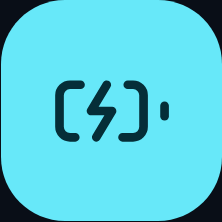

<table role="presentation" border="0" cellpadding="0" cellspacing="0" style="border: 0; border-collapse: collapse;">
<tr style="border: 0;">
<td valign="middle" style="border: 0; padding: 0 12px 0 0;"></td>
<td valign="middle" style="border: 0; padding: 0;"><p role="heading" aria-level="1"><strong><font size="7">Apple Battery Scout</font></strong></p></td>
</tr>
</table>

[](https://github.com/DavidNzube101/applebatteryscout/actions/workflows/ci.yml)


## Running locally

```sh
bun install
bun run dev
```

- `/` landing page
- `/app` battery analytics checker

- `bun run check` typecheck
- `bun run test` unit tests
- `bun run build` production build

## Author

David Nzube · [X](https://x.com/davidnzubee)

## License

[MIT](LICENSE)
